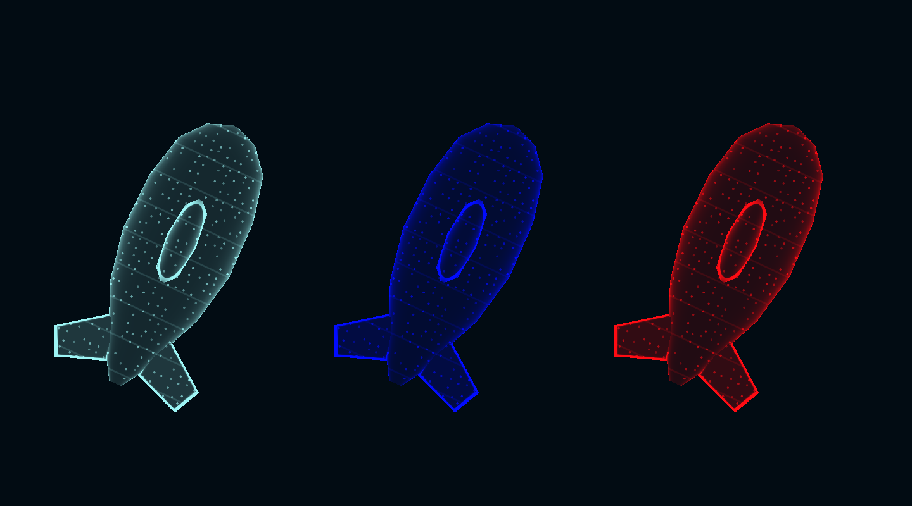
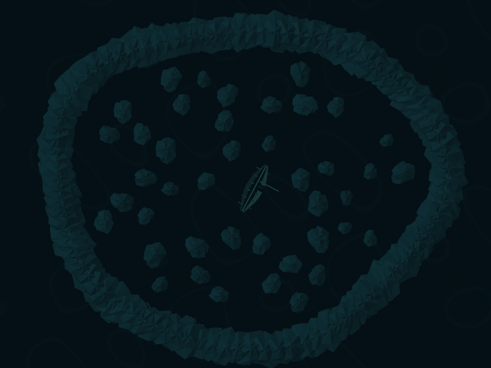

# Onderwater-testmap

`Assets/Scenes/Game.unity` bevat een vaste, bewerkbare onderwaterarena van ongeveer 84 × 68 Unity-eenheden. Start het spel zoals gebruikelijk vanuit Bootstrap of MainMenu.

De donkere navy/zeegroene sfeer blijft unlit. Zonder sonar rendert alle geometrie, inclusief de zeebodem, als exact dezelfde egale kleur als de camera-achtergrond (#020C13). Er zijn dan geen vlaktinten, contourlijnen of transparante uitsparingen. Sonar voegt tijdelijk oppervlaktinten en sonarkleur toe. Na de sonarreactie vervagen ze weer volledig; colliders blijven actief.

## Assets bekijken en hergebruiken

Alles staat in `Assets/Art/3D/Environment/Underwater/`:

- `Prefabs/Basalt_01` t/m `Basalt_04`: vier onregelmatige steenvormen met meshcollider en sonarreactie. Zowel de rand als de losse rotsen gebruiken deze prefabs.
- `Prefabs/Broken_Survey_Vessel`: open scheepsromp, gebroken huid, zichtbare spanten, kiel en gevallen mast. Onderdelen zijn afzonderlijk te selecteren.
- `Prefabs/Seabed`: golvende zeebodem.
- `Meshes/`: de blijvend opgeslagen Unity-meshassets van alle bovenstaande modellen, inclusief de wrakbalken.
- `Materials/`: Basalt, Silt en Wreck. Pas hier de oppervlaktinten tijdens onthulling en de contoursterkte aan.

Selecteer een mesh in het Project-venster voor de geometriepreview, of open een prefab door erop te dubbelklikken en gebruik Wireframe om de vorm te bekijken. Het spelmateriaal verbergt de geometrie ook buiten Play Mode zolang er geen sonar actief is. Er wordt bij het starten van een spel **niets opnieuw gegenereerd**. De oorspronkelijke FBX-stenen in `Environment/Rocks/Models` zijn behouden; deze map gebruikt de vier nieuwe vormen.

## Onderzeeer

Het spelerprefab gebruikt nu een opgeslagen onderzeeermodel met een slanke romp, verhoogde toren en twee kleine staartvinnen. De donkere unlit romp heeft lichtcontouren, fijne rompsegmenten en stippen in de spelerskleur, passend bij de sonarwereld. Het patroon staat in objectruimte zodat het met de boot meebeweegt. Spelers blijven zichtbaar zonder sonarpuls; de onthullingsregels voor rotsen en wrakdelen worden niet op spelers toegepast.

De assets staan in `Assets/Art/3D/Players/Submarine/`: `Meshes/SonarSubmarine.asset`, `Materials/SonarSubmarine.mat` en `Prefabs/SonarSubmarine.prefab`. Het losse prefab is bedoeld om het model in de assets te bekijken en te hergebruiken; `Assets/Prefabs/Players/Player.prefab` blijft het netwerkspelerprefab. Op het materiaal regel je **Hull visibility**, **Luminous contour strength** en **Sonar point brightness**. De kleur wordt tijdens het spelen door `PlayerVisualController` ingesteld.

Alleen de visuele mesh en materialen van de speler zijn vervangen; het oude blokje is als renderer uitgezet. De bestaande colliders, transforms, schietpositie en netwerkcomponenten zijn behouden. Er worden tijdens het spelen geen modellen gegenereerd. **Echo / Build Submarine Visual Assets** bouwt de opgeslagen mesh en het losse voorbeeldprefab opnieuw en overschrijft handmatige modelaanpassingen aan deze gegenereerde assets.

## Grenzen en spawnplekken

`Underwater Arena` bevat een convexe, asymmetrische kustlijn in wereld-XZ. `PlayerMovement` begrenst iedere netwerkstap tot die kustlijn, met 0,85 eenheid marge voor de speler. Een spherecast tegen de arena verhindert beweging door stenen en wrakdelen, ook bij versnellen. De aaneengesloten colliderstroken langs de rand sluiten de arena fysiek af. Beweging blijft op Y = 0.

De twaalf `Dive point`-objecten onder `Spawner` liggen verspreid over buitengebieden en binnenroutes. Rond ieder punt is twee eenheden obstakelvrije ruimte gereserveerd; onderlinge afstand is minimaal acht eenheden. Spawnselectie slaat geblokkeerde of onveilige punten over, geeft voorkeur aan afstand tot andere spelers en gebruikt bij gelijke afstand de minst recent gebruikte plek. Dit geldt ook bij respawns. Bij volledige bezetting wordt de ruimste geldige plek gebruikt.

Selecteer `Underwater Arena` om de grens te zien; spawnplekken hebben cyaan gizmo's. Houd bij handmatige wijzigingen de kustlijn convex en tegen de klok in; de arena-root en spawner blijven op de oorsprong.

## Sonargolf

`WorldSonarPulse` berekent per uitgezonden puls één straal vanaf een vast wereldpunt. De zichtbare ring en de oppervlakteshader gebruiken exact diezelfde straal. Iedere pixel wordt op zijn XZ-wereldafstand tot dat punt onthuld zodra de golf daar passeert. Onthulling blijft onafhankelijk van UV's en particlebotsingen.

`SonarPropagation` bepaalt bij het uitzenden met 1024 horizontale richtingen de eerste collider in iedere richting. Zowel de lijn als de onthulling gebruiken dezelfde akoestische schaduwkaart. De onthulling gebruikt een ruimtelijk masker per pixel, onafhankelijk van vlakrichting, triangulatie en UV-mapping. Per richting wordt de echte colliderdikte gemeten; het voorste gedeelte (tot halverwege die dikte) kan oplichten, met een zachte overgang van maximaal 0,2 eenheid. Daardoor kan een enkel vlak gedeeltelijk zichtbaar zijn, ook een vlakke bovenzijde. Het achterste gedeelte en objecten achter het obstakel blijven donker. Directe en teruggekaatste golven krijgen ieder hun eigen masker. Openingen in een wrak blijven afhankelijk van de werkelijke meshcolliders. De kaart wordt één keer per golf opgebouwd voor de statische testmap.

Op geraakte obstakels ontstaan zwakkere teruggekaatste boogjes. Ze beginnen pas zodra de golf het oppervlak bereikt en volgen de spiegelrichting van de vlaknormaal. Per obstakel worden meerdere invalshoeken onderzocht. Routes naar verschillende andere objecten krijgen voorrang, vooral wanneer die objecten niet rechtstreeks bereikbaar zijn. De echo kan die objecten daadwerkelijk onthullen, ook als de directe sonargolf wordt geblokkeerd.

De volledige afgelegde route telt mee in bereik en looptijd; een echo krijgt geen nieuw volledig bereik. Ook teruggaande golven worden door andere obstakels geblokkeerd en kunnen opnieuw reflecteren. Standaard worden maximaal acht eerste reflecties geselecteerd en maximaal twee vervolgreflecties per echo, tot drie weerkaatsingen per route. Iedere weerkaatsing houdt 55% van de vorige kleursterkte over en heeft een halve spreidingshoek van 12 graden. Dit is instelbaar via `Max Reflections`, `Max Bounces`, `Reflection Strength` en `Reflection Half Angle`. Het blijft een beperkte spelbenadering zonder diffractie.

Op `PlayerSonarBehaviour` kun je onder **Pulse** bereik, looptijd, `Radius Curve`, breedte van de voorrand, `Hold Duration` en uitfade aanpassen. De curve loopt van (0,0) naar (1,1) en hoort oplopend te zijn. Standaard reist de ping 27,75 eenheden in 1,85 seconde (15 eenheden/seconde). Een geraakt oppervlak houdt de kleur 2,5 seconden vast en vervaagt daarna in 1,5 seconde. Per druk op Ctrl wordt één puls verstuurd, met minimaal 0,4 seconde tussen pulsen. De hoofdsonar gebruikt dezelfde kleur als de onderzeeër. De kortere inslagpuls gebruikt dezelfde instellingenstructuur op `SonarImpact` (9 eenheden in 0,6 seconde).

De visuele stijl volgt de menuachtergrond `Assets/UI/Echo/Textures/MenuOcean.png`: fijne lichtpuntjes op de oppervlakken, dunne bathymetrische hoogtelijnen en een gestippelde uitgaande sonarlijn met een zwakke verbindingsgloed. De vulling blijft unlit, maar is iets sterker voor een herkenbaar silhouet binnen het onthulde deel. Grotere lichtpuntjes en duidelijkere hoogtelijnen maken de vorm leesbaarder. De sonarlijn heeft grotere stippen en een beter zichtbare verbindingsgloed. Het patroon staat vast in wereldruimte en vereist geen UV-mapping, textuur of extra 3D-assets. Alle stijlhelderheid wordt met de oorspronkelijke spelerskleur vermenigvuldigd; er is geen vaste cyaan- of witkleur toegevoegd. Onthullingsmasker, looptijd, vasthouden, uitdoven, blokkering en reflecties blijven gelijk.

De materialen Basalt en Wreck hebben **Sonar point spacing**, **Sonar point brightness**, **Faint surface fill**, **Sonar brightness** en **Contour strength** voor de uitstraling. De standaardvulling is 0,18 en de helderheid 1,35; helderheid verhoogt het oppervlaktesignaal zonder extra delen te onthullen of de spelerskleur te vervangen. `Assets/Resources/SonarRing.mat` heeft afzonderlijke **Sonar ring point spacing** en **Faint connecting trace**. Stel de spelerskleuren voor een match in op `PlayerVisualController` in `Assets/Prefabs/Players/Player.prefab`: **Own Player Color** en **Other Player Color** zijn de standaardkleuren. Via **Player Color Overrides** kun je per Fusion **Player Id** een eigen kleur invullen. Deze kleuren gelden voor onderzeeër, sonar en projectielen. `PlayerColor` blijft het aansluitpunt om een individueel gespawnde speler vanuit code een andere kleur te geven; een keuzemenu of synchronisatie van keuzes tijdens de match is hiermee nog niet toegevoegd.

Botsen tegen stenen, wrakdelen of de arenagrens geeft een korte contactpuls. De swept movement-controle meldt het contact direct, omdat de boot al voor een fysieke collision-event wordt tegengehouden. De state authority verstuurt de puls naar alle clients; de oorsprong ligt net buiten het geraakte oppervlak en gebruikt de spelerskleur. Tegen een obstakel aan blijven varen geeft geen voortdurende pulsen. `PlayerSonarBehaviour / Collision Pulse` regelt de contactpuls (standaard 9 eenheden in 0,6 seconde), met minimaal 0,65 seconde tussen contacten.

De zeebodem krijgt geen blijvende kleur: `Silt.mat` heeft `Reveal solid object` uitgeschakeld. Daardoor zie je één dunne uitgaande ringlijn, zonder gevulde sonarschijf. Stenen en wrakdelen houden hun sonarkleur wel vast, met lichte vlakcontrasten voor de leesbaarheid van hun vorm.

Maximaal 32 pulsen (inclusief echo's) kunnen gelijktijdig doorlopen. Echo's verdringen nooit een primaire golf. De sterkste kleurbijdrage blijft per pixel zichtbaar. Iedere puls blijft op zijn oorspronkelijke zendpunt, ook als de speler beweegt of het inslagobject al is verwijderd. Lijnen worden tijdens het spel getekend met LineRenderer; het blijvende materiaal staat in `Assets/Resources/SonarRing.mat`. De shaders staan in `Assets/Art/Shaders/`, met gedeelde schaduwlogica in `SonarOcclusion.hlsl`.

Andere wereldmodellen doen mee met `Echo/Underwater Unlit`. Voor blokkering/reflectie hebben ze een passende niet-triggercollider nodig en staan ze onder `Underwater Arena`, of hebben ze een `SonarObject`-marker op het object/een ouder. De huidige geometrie gebruikt statische colliders; spelers en andere Rigidbody-objecten worden niet als obstakel behandeld. Sonarschaduw raakt alleen de sonarweergave, niet de gewone zichtbaarheid van spelers.

## Editorcommando's

- **Echo → Validate Sonar Visibility** controleert Basalt, Wreck en Silt zonder colliders: exact onzichtbaar vóór/na sonar, geen onthulling vóór de golf, lineaire en versnellende curves, identiek beeld zonder/met onbruikbare UV's en overlappende pulsen. Voer dit buiten Play Mode uit.
- **Echo → Validate Sonar Shadows and Reflection** controleert met afzonderlijke testgeometrie dat een muur de golf blokkeert, de lijn erachter verdwijnt en een schuine reflector een rechtstreeks verborgen object wel onthult. De test controleert ook dat dit object donker blijft tot de volledige indirecte route is afgelegd, en dat zichtbare en verborgen pixels binnen dezelfde vlakke driehoek liggen, met een zachte overgang, ook bij een echo.
- **Echo → Validate Live Sonar Pulse** voer je uit nadat een hostspeler is gespawnd. Het controleert de speler-RPC, gelijke straal voor ring/onthulling, een netwerkinslag, voortzetting na despawnen van de inslag en volledige uitdoving. De controle stopt Play Mode na afloop.
- **Echo → Validate Underwater Test Map** controleert spawnruimte/spreiding, 720 grens- en bewegingsproeven, botsingen door losse rotsen, opgeslagen meshes en shadercompilatie. Open hiervoor Game.unity buiten Play Mode.
- **Echo → Preview Underwater Test Map** schrijft een bovenaanzicht naar `docs/underwater-map-preview.png`.
- **Echo → Build Underwater Test Map** bouwt dezelfde vaste map opnieuw. Dit vervangt de arena en spawnplekken in Game.unity en overschrijft de gegenereerde assets; handmatige wijzigingen daarin gaan verloren. Overige gameplay-, netwerk- en UI-objecten blijven behouden.

De controles zijn uitgevoerd in Unity 6000.6.7f1. Een volledige multiplayer-speeltest met twee clients blijft afzonderlijk nodig.

